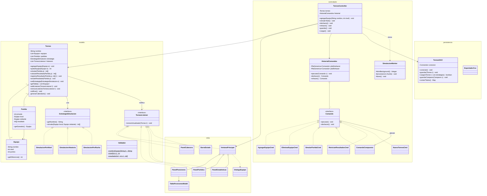

# Diagrama de clases — E-Sports League Manager

Corresponde al código final de `src/`. GitHub lo muestra como diagrama. La imagen `../diagrama-clases.png` es la versión simplificada que se usó en la presentación.

